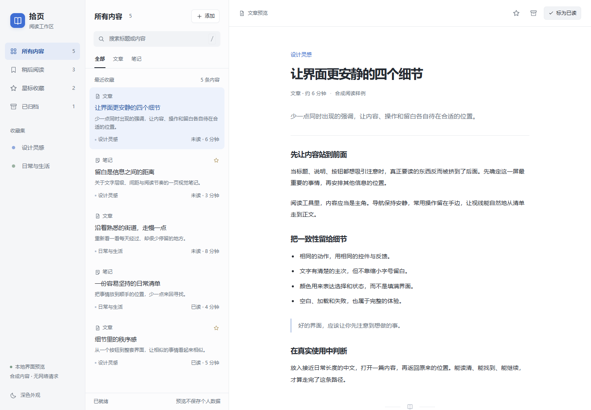

# 可复用的云端 AI 项目工作流

协作规则版本：0.5.7 · 2026-10-24（简版 r12）。接入/检查配置协议仍为 0.1；协调器协议 1，标准库实现。适用于个人项目，以手机App实际体验与约定成品交付为重点；网页或桌面按用户当次目标执行；由代理执行，用户不需要填写技术表格或使用本地电脑。

**默认采用[许愿式编程闭环](INTAKE.md#许愿式默认闭环)：**代理整理完成条件、选择可纠正默认并推进；同项目由明确负责人承担云端 Codex、本地 Codex、DSH 的协作、主动接续、自检和收尾。用户只表达用途、偏好和反馈，实施中的“不好用”继续处理，不以流程建设或发版状态代替实际体验。

**当前成品目标与设计偏好。** 用户希望自然语言提出需求，由代理负责直到自己的 GitHub 开源仓库有可下载使用的成品。对任务中已明确的“开源、下载使用”，把源码、许可证、正式 Release、对应安装包、下载核验和更新保数据纳入完成条件，沿现有授权持续收尾，不在完成代码后另问是否打包发布。已有私有项目不因此批量转公开；发布前沿隐私扫描、许可和原签名规则处理，必要的本人授权仍保留。苹果产品的精致统一，与优秀开源软件的清爽实用，是当前两种默认视觉参考；按用途选一套，真实查看对应参考与最终画面，不把“开源”当单一皮肤或混搭控件。用户只需表达目标、偏好和体验，代理承担技术调度与首轮排错。

**完成须分清三件事：**主要用途在最终产物上可操作并按风险检查保存重开/错误恢复；真实界面、中文、小屏及相关大字状态经过查看，实质视觉改版按需由未参与实现者复核；GitHub 发行、附件与访问条件实际读回，必要时下载核对摘要。沿现有 [DELIVERY](https://github.com/h516df/vibe-ui-quality-kit-open/blob/main/workflow/DELIVERY.md) 和检查/发布工具执行，用户无需填写验收表。构建、流程更新、脚本自检或发布元数据不能证明全部可用；目标设备或安装升级未实际访问就标未验，不凭文件更新宣称所有云端会话已加载或任意需求可以无人介入交付。

**默认由代理采用，用户无需重复说“使用这套工作流”。** 用户只表达想做什么；代理在已知本工作流且有目标项目权限时，自己检查既有规则、选择适用步骤、接入缺失文件并记录固定版本。用户当前指令优先；不因采用流程增加确认或技术填表。

接入和升级是代理的工作。已接入项目沿用本仓库 AGENTS 和本地规则，不每次重新安装或重复询问。尚未接入的项目，在本工作流已进入代理上下文时默认处理；不得为此扫描、批量改写其他无关仓库。

**生效范围要如实说明：**本仓库文件不能单独设置 GitHub/ChatGPT/Codex 的账户级默认指令，也不会自动加载进无关的新会话。当前连接没有账户级指令写入能力。只有项目规则或所用环境的受支持全局指令已经被读取时，才能跨任务自动沿用；不得承诺所有未来会话均会记得。

**主动适应与独立判断。** 日常任务默认结合联网资料、已有成果与实际验证；沿用已明确偏好和最近纠正，识别前提错误与更合适方案，优化直接服务当前目标。规则源、可读取入口、实际任务表现分别核实，不能用文字同步冒充端到端验收。见 [CORE](CORE.md)。

## 跨项目统一入口

本目录是已有 12 个项目入口共用的通用来源；当前采用范围以 [REPOSITORIES.md](REPOSITORIES.md) 为准。各项目 AGENTS 指向这里，并保存独立简要规则；[CORE.md](CORE.md) 为当前 r12。本次更新工具库默认入口与新项目模板，保留历史采用回执；已有项目实际读取统一入口时可采用 0.5.7，其离线简版仍按各自已保存版本执行。代理在获授权的项目任务中审阅并更新过时入口，不要求用户复制启动语；私有库不可读时说明使用本地简版，不能声称已读到新版。项目特有约定保留，不批量改写无关仓库。

采用状态与本轮范围见 [REPOSITORIES.md](REPOSITORIES.md)。规则文档的落地不代表账户级设置或任何业务 PR 已合并。

## 本次任务怎样开始

明确开发/修复/继续实施的请求直接推进；先讨论和独立候选想法先收集，持续网页试用中的体验反馈接续调整。没有固定开工口令，也不把明确实施请求只记成待办。每批先固定已明确要求，尽早展示代表体验，网页反馈持续调整、按变化检查、及时更新同一预览；用户明确要求后才正式发行，不为每次试改重做整套发行流程，也不增加开工口令。见 [反馈迭代节奏](INTAKE.md#反馈迭代节奏)。新云端任务先查当前连接与相关 PR，不假定继承旧会话。

## 包含什么

- [离线阅读工作区预览](templates/ui-foundation.html) 与 [样例CSS](templates/ui-foundation.css)：导航、清单和阅读区域围绕同一用途组织，小屏分开清单与正文；搜索、星标、已读、归档、添加及返回可操作，浅深色一致。内容仅在本次页面保留。用户已否定旧版卡片样例；新稿仍待审美反馈，不作为所有产品的默认皮肤。

  

- [需求与实际结果对应](WORKFLOW.md#quality-evidence)：由代理沿原任务关联完成条件、代表操作与当前证据，先跑通完整用途、检查代表界面，再按影响补齐本批；不增加用户表格或固定审查轮次。

- [按用途选择两种审美方向](STYLE.md)：苹果产品质感与优秀开源软件的清爽实用，落实到构图、内容密度、文字和控件主次；主写手负责，不要求用户填写风格问卷。
- [开源连续实施路线](OPENSOURCE_EXECUTION.md)：已有多步骤计划时，由代理按需采用固定提交的 Superpowers 原版内联执行技能和辅助脚本；本机隔离试用已完成，云端按当前环境核对采用，不让用户逐任务下指令。

- [MULTI_CODEX.md](MULTI_CODEX.md)：多个独立 Codex 的任务领取、范围冲突、移交与统一整合；[coordinate.py](scripts/coordinate.py) 提供 Git 原子更新和连接器计划模式。

- [INTAKE.md](INTAKE.md)：意图判断、唯一需求池、批次与状态；[需求池模板](templates/BACKLOG.md)。
- [DELIVERY.md](DELIVERY.md)：用户交付目标、构建/鉴权故障分层、正式发行状态与原生附件核验；[verify_release.py](scripts/verify_release.py) 生成只读发布回执。
- [CLOUD_CAPABILITIES.md](CLOUD_CAPABILITIES.md)：新项目的能力核对、已有 Make 建仓通道及实际验证边界。
- [安卓交付模板](templates/ANDROID_DELIVERY.md)：按需核对签名恢复、更新、数据迁移和实体手机；不是已实现功能。

- [RESEARCH.md](RESEARCH.md)：主动查找网上/GitHub/官方文档和成熟产品，实际查看、比较、复用与验证。
- [WORKFLOW.md](WORKFLOW.md)：需求、设计、开发、检查、发布、交接和成本控制。
- [templates](templates)：AGENTS 补充规则、单次任务、交接、设计与项目检查配置。
- [scripts/workflow.py](scripts/workflow.py)：云端接入、分层检查、远端提交核对与只读接续；只需 Python 标准库和 Git。自动读取 PR 时复用现有 gh 登录，连接器快照方式无需 gh。
- [templates/ci.yml.example](templates/ci.yml.example)：可选的轻量 CI 示例。需要按项目补上依赖安装、测试命令及路径过滤，不会自动启用发布或收费服务。
- [tests](tests)：接入幂等、冲突不覆盖、未配置测试不报通过、检查失败传播、远端核对等自检。

## Git 传输故障后的源码恢复

普通 Git 仍是首选。确认 TLS、代理或连接故障后，代理可使用现有 GitHub CLI 认证，通过 GitHub Git 数据 API 恢复同一源码；不需要用户改网络或重新登录。401/403、权限、安全拒绝和分支保护继续按原要求处理，不能用本入口绕过。

`recover-git` 默认只检查本地并输出计划，不联网、不写工作区。代理核对目标后加 `--apply` 执行；这不是额外的用户审批步骤。已接入项目使用 `cloud/workflow.py`，工具库使用下列入口：

```bash
python3 workflow/scripts/workflow.py recover-git --target <repo> --operation publish --expected-head <source-sha> --apply
python3 workflow/scripts/workflow.py recover-git --target <repo> --operation publish --expected-head <next-source-sha> --expected-remote-head <current-task-tip-sha> --apply
python3 workflow/scripts/workflow.py recover-git --target <repo> --operation sync --expected-head <old-local-sha> --remote-head <reviewed-merge-sha> --apply
```

- 发布限已有公开仓库、干净工作区、一个未签名的非合并源码提交。默认只从当前默认分支创建新任务分支；接续已存在的同一任务分支时，代理现场读取其 tip，显式传 `--expected-remote-head`，它必须恰好是本地提交的唯一父提交。只做非强制快进，不发布默认分支，不改写其他写手的提交。支持 UTF-8 普通文件和删除，限 100 文件、单文件 1 MiB、合计 5 MiB；二进制、子模块和已签名源码提交沿原 Git 路径处理，不能剥掉签名。
- 发送前扫描本次提交中的新增内容和提交说明，忽略未提交配置；创建远端 ref 前核对完整 tree 和原 commit SHA。相同分支已存在且 SHA 一致时直接返回 `already_present`，不再写入。API 回执不明先读回 ref，不盲重放。
- 合并同步需要明确的已审阅 SHA、干净的默认分支和本地已有的树及父提交。缺少合并对象时，只从 GitHub 已验证签名的 payload 重建并核对原始哈希，再执行快进；不 reset，不选择或合并 PR。重复执行返回 `already_current`，不写远端。
- 默认继承现有网络。已确认直连可用才按需加 `--network direct`，只改变该子进程环境；CLI 不在 PATH 时用 `--gh <existing-gh>`，不会安装、登录或扩大权限。正常发布前的隐私、许可证和项目验收仍适用。

协议依据：[GitHub Git Trees API](https://docs.github.com/en/rest/git/trees)、[非强制更新 ref](https://docs.github.com/en/rest/git/refs#update-a-reference)。服务器拒绝并发发生的分叉更新；回执不明后先读精确任务 ref，相同 SHA 只读接续，不自动重放。传入已存在任务 tip 而远端分支缺失时停止，不自行重建。本入口仅处理上述源码传输恢复，不表示安装包发行或目标设备验收已完成。

## 云端接入

在已授权的云端目标仓库内，先查看计划，再应用：

```bash
python3 /path/to/kit/workflow/scripts/workflow.py adopt --target /path/to/project
python3 /path/to/kit/workflow/scripts/workflow.py adopt --target /path/to/project --apply
```

脚本添加 `docs/AI_WORKFLOW.md`、`cloud/workflow.py`、`cloud/coordinate.py`、`cloud/verify_release.py`、`cloud/resume_status.py`、`cloud/git_recovery.py`、`cloud/privacy_scan.py`、`docs/DELIVERY.md`、`.ai-workflow.json`；向 AGENTS 追加链接，根 HANDOFF 仅在缺失时创建。既有文件发生冲突会在写入前终止。不会初始化 Git、推送、安装依赖、运行恢复工具或发布服务。

接入后，由代理根据已有命令填写 `.ai-workflow.json`。`quick` 是语法/配置等廉价检查；`core` 是实际主要功能。没有配置检查、当前层没有选中检查、或 core 没有功能检查时返回 2 / NOT CONFIGURED，不能以空白检查冒充通过。配置中的命令与项目脚本同样属于可信代码，执行前须审阅。

```bash
python3 cloud/workflow.py check --level quick
python3 cloud/workflow.py check --level core
python3 cloud/workflow.py receipt --remote origin --branch task-branch
```

源码 `receipt` 不等于产物发布成功。GitHub 发布按 [DELIVERY](DELIVERY.md) 的显式契约执行 `python3 cloud/verify_release.py --contract release/delivery-contract.json --receipt /tmp/release-receipt.json`；失败不能交付旧的成功回执。

`receipt` 比较 GitHub 远端分支与当前 HEAD，并要求工作区干净。Git CLI 无认证时，使用已连接 GitHub 工具读取远端 ref，记录准确 SHA，不能声称脚本已通过。

## 让代理恢复已有项目

同一任务的源码、写手和已有证据仍有效时，代理直接继续，不逐步重跑接续查询。正在编码且已掌握当前产物/交付事实时，可用 `resume --github --skip-release`（也支持连接器快照）核对PR与源码基线，减少一次发行查询；`delivery.status=not_requested` 明确表示未读取，不当作发行查询失败或已验收。首次接手未知版本、打包发布或下载核验时仍使用完整读取。缺失、过时或不完整的PR信息继续如实报错，产品验收保持独立。

JSON输出采用紧凑格式，保留相同字段和值，避免反复传输缩进空白；需要人工查看时可沿用标准JSON格式化工具。该选项减少特定接续阶段的查询和输出，不承诺整个开发任务固定省额比例。

### 按当前问题收拢上下文

需要定位代码时，代理从当前问题选少量关键词或符号，使用同一入口：

```bash
python3 /path/to/kit/workflow/scripts/workflow.py resume --target /path/to/project --focus "save archive"
```

`--focus` 可与 `--github` 或连接器快照并用。它只检索已跟踪工作树，最多返回8个相关代码/Markdown文件的位置、内容摘要哈希，以及每文件最多6个声明名和行号；不回传源码正文、字符串值或未跟踪文件，不执行模型或项目脚本。单文件超过128 KiB只给定位提示；无匹配是正常结果，截断明确标记。声明只是阅读线索，代理仍须核对实际调用关系，不能把关键词匹配当完整影响分析或验收。

由代理据此先读相关入口及直接依赖，再按证据缺口扩展，用户无需挑文件或输入关键词。现有 TASK/HANDOFF 保留当前约定、最近纠正和下一步应读的位置；需求变动只更新差异及受影响证据，不因每次聊天重新准备整套规格。

本轮借鉴 [OpenSpec](https://github.com/Fission-AI/OpenSpec) 的需求/变更分离和 [Aider repository map](https://github.com/Aider-AI/aider/blob/main/aider/website/docs/repomap.md) 的相关上下文与预算思路，沿用已有Git及Python标准库。没有引入额外Agent、模型配置、持久索引或后台循环；上下文减少幅度取决于实际项目，不承诺固定省额比例。

接续输出新增 `brief`：将本次最先该处理的问题收拢为一句中文和一个代理负责的动作。先保护未提交改动、辨明 detached HEAD，再按远端信息完整性、源码一致性与当前 PR 检查状态处理。检查失败优先诊断，检查进行中继续可独立工作，缺失/跳过/未知检查先核对项目要求；其他 PR 的失败不冒充当前源码失败。多个相关 PR 不自动选一个。

`brief` 是代理的只读线索，不自动执行、修改模型或派发任务，不凭探测结果推断用户必须操作或代理已获得写手权限。来源、下载与产品验收仍需分别验证。过时或不完整的仅 PR 快照也返回 exit 2；本地模式的 `not_read` 保持明确且不当作读取失败。由代理消化技术字段，向用户先报告实际变化、可用入口与确需本人处理的最小一步。

复杂接续时由代理执行，不要求用户记命令。新接入项目已有 `cloud/resume_status.py`；旧项目先审阅补入两个脚本，或从本工具库运行，不能把共用源更新说成所有项目已安装。

```bash
python3 /path/to/kit/workflow/scripts/workflow.py resume --target /path/to/project --github
```

命令只读当前 Git 身份、是否有未提交改动、已有交接入口，并通过现有 gh 认证各有界读取一次开放 PR 列表和默认分支实际提交。不 fetch、checkout、修改工作区、登录、派发任务、自动挑最新 PR 或合并。最多读取 100 项，达到上限标记不完整。失败不重试，返回仍可确认的本地信息和 exit 2；代理可沿已有 GitHub 连接器补读，不能声称已掌握远端。未请求 GitHub 的本地模式明确标 not_read。

`source_baseline` 取 GitHub 默认分支的名称与实际提交，不把本地可能过时的 `origin/main` 或 ahead/behind 计数当最新状态。当前就在默认分支而提交不同时，提示先比较原成果与远端，再决定接续基线；保留未提交改动的优先级更高。不自动拉取、覆盖或接管写手，也不把差异武断说成“落后”。功能分支只显示参考；与默认分支不同不自动阻塞开发。PR、默认分支与发行查询独立保留成功结果，其中一个失败不丢弃其他已读信息。

`--github` 现额外有界读取一次 `/releases/latest`，只投影版本、公开入口和附件元数据，不复制发布正文、作者或账号信息。`delivery` 单列发行候选及附件名/大小/GitHub记录的SHA256；来源、下载和设备检查仍为 `not_verified`，不选安装包、不自动下载安装。没有附件、未上传、草稿/预发行、查询失败和过时快照分别标注；发布查询失败仍保留PR与本地信息，返回2表示读取不完整。原有仅PR的连接器快照继续兼容；可选添加 `latest_release`（同一次读取的GitHub Release白名单字段；不可见或缺失时为null），没有该字段则明确未读取发行。含敏感查询参数、账号或其他仓库的链接不能成为发行候选。

只有连接器时，代理把当前授权连接的 PR 字段规范化为以下快照，保存到任务自己的临时目录，传 `--github-json /tmp/project-prs.json`。`observed_at` 是实际读取时间；`complete` 是是否取得全部开放 PR，不能凭截断搜索设 true。`headRefOid` 必须是源仓库实际 head，不能填测试成功的旧 SHA。可选添加 `default_branch: {"name":"main","head":"<实际40位提交>"}`，名称须来自仓库实际默认分支；读取失败写null，旧快照未提供时明确标 not_read。只记录必要元数据，不复制正文、账户信息或密钥。

```json
{
  "repository": "example/product",
  "observed_at": "2026-10-23T12:00:00+00:00",
  "complete": true,
  "pull_requests": [
    {"number": 2, "title": "保存后重开", "url": "https://github.com/example/product/pull/2",
     "headRefName": "codex/save", "headRefOid": "aaaaaaaaaaaaaaaaaaaaaaaaaaaaaaaaaaaaaaaa",
     "baseRefName": "main", "isDraft": true, "statusCheckRollup": []}
  ]
}
```

快照超过 24 小时或不完整要求刷新；本地/远端源码不一致提示先比较。空检查标 not_run，失败、进行中、跳过和未知状态不合成全绿。输出只给接续线索：负责人仍须读取原交接、用户最近纠正和现有协调登记，核对写手及真实入口；PR 检查成功不代表产品验收。这是现有流程的只读辅助，不是新任务库、自动后台或模型调度器。

本轮参考 [GSD 的接续与验收](https://github.com/open-gsd/gsd-core/blob/main/docs/how-to/verify-and-ship.md)、[BMAD Loop 的确定性验证与预算](https://github.com/bmad-code-org/bmad-loop#how-a-story-flows)：采用明确的接续状态和空验收拒绝；保留现有执行入口，没有安装实验循环器、自动多会话或要求用户逐项确认测试。

## 版本与复用边界

这是工作约定和工具，不绑定网页框架、模型、部署商或 Android 技术栈。不自动复制 TimeWorth 的功能、账户数据、图片或凭据。不把浏览器通过等同于安卓真机通过。单独目录可移植，更新由目标项目审阅差异后进行。

官方参考：[OpenAI Codex 实践](https://learn.chatgpt.com/guides/best-practices)、[Playwright 测试实践](https://playwright.dev/docs/best-practices)、[截图比较](https://playwright.dev/docs/test-snapshots)、[GitHub 工作流并发](https://docs.github.com/en/actions/how-tos/write-workflows/choose-when-workflows-run/control-workflow-concurrency)。规则针对本用户的云端、低操作成本偏好做了调整。

修改 Actions 配置时额外运行语义校验；本包的 CI 示例和 TimeWorth 配置已用 [actionlint](https://github.com/rhysd/actionlint) 1.7.7 检查，通过官方发布校验和核对工具下载。单纯 YAML 解析不会发现所有 GitHub 表达式上下文错误。工具二进制不进入本库。

## 隐私与凭据

公开仓库、发布正式包或对外交付之前，先跑 [隐私与凭据检查](PRIVACY.md)：python workflow/scripts/privacy_scan.py <仓库根目录>。测试样例用真实店铺、地址、手机号是这类泄露最常见的入口。
